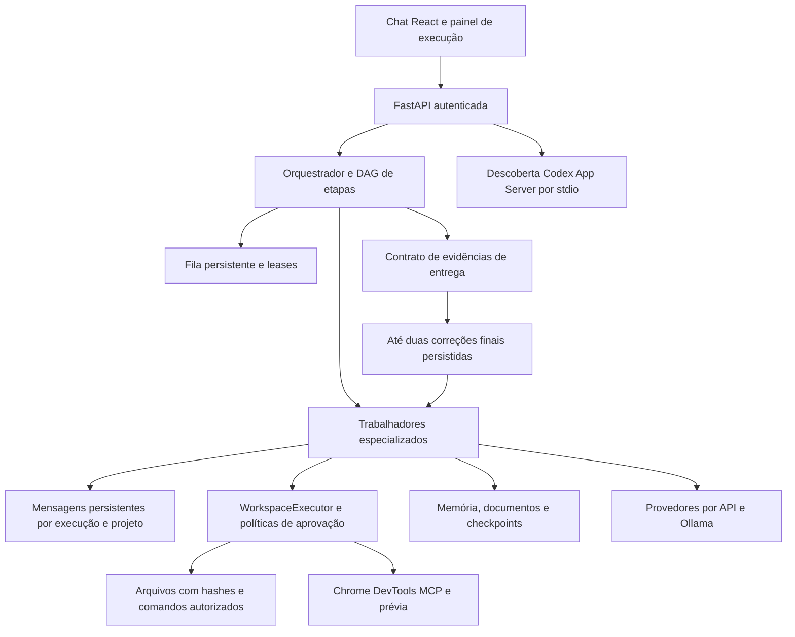

# Evolução OpenBot — estado verificável em 28/10/2026

Atualização posterior: a execução persistente do Codex e novos ensaios reais estão
documentados em [Codex integrado e etapas restantes](EVOLUCAO-CODEX-ETAPAS.md).
As pendências abaixo descrevem o estado da primeira entrega incremental.

Esta entrega é incremental. A missão completa de quinze fases permanece aberta.
Testes de regressão aprovados não comprovam todas as integrações solicitadas.

## Auditoria e recuperação

Workspace: `C:\Users\marco\Documents\Central-de-Trabalhadores-IA-MVP\central-trabalhadores-ia`.
Branch: `feat/isolated-preview-semantic-memory`; HEAD `7e62cb8`.
O HEAD remoto dessa branch foi confirmado por `git ls-remote --heads origin`.
`main` remoto: `3471948`. Existem branches locais de consolidação e backup.
As alterações locais anteriores foram mantidas; não houve checkout, merge ou push.

Backup: `C:\Users\marco\Documents\Central-de-Trabalhadores-IA-MVP\backup-openbot-20261028-200744`.
Código conferido por SHA-256, sem divergências. Banco SQLite de 15.327.232 bytes
capturado pela API de backup SQLite, criptografado com Fernet e verificado com
`integrity_check` e `foreign_key_check`. O diretório tem ACL restrita à conta Windows.
`recovery.key` permite recuperar `data.fernet`; mantenha ambos fora de repositórios.
Foi realizada também uma restauração em pasta temporária: contagens antes/depois
iguais para usuários (1), projetos (3), conversas (15), mensagens (125), agentes
(11), provedores (14), recursos (30) e checkpoints (42).

Para restaurar o banco em OUTRA pasta inexistente, carregue `recovery.key` em
`CENTRAL_BACKUP_KEY` apenas no processo de recuperação e utilize
`central.backups.restore(source, destination)`. Nunca copie um SQLite ativo
ignorando o WAL. A restauração não substitui o banco em execução.
Para retornar o código, compare os arquivos do backup com o workspace, preserve
alterações posteriores e restaure somente os arquivos escolhidos. Recompile o frontend.

## Arquitetura atual e direção



O desenho mantém o produto Central. Workspaces, permissões e eventos existentes
continuam sendo a fronteira de execução. Uma skill ou mensagem não concede acesso.
O Codex ainda aparece apenas como descoberta de runtime, não como executor do DAG.

## Alterações desta entrega

- `central/agent_messages.py`: mensagens tipadas, destinatários participantes,
  isolamento de proprietário/projeto/execução, entrega idempotente, limite de 100
  pedidos de tarefa e profundidade oito. Ancestralidade total limitada a 64 mensagens.
- Migration 15: tabela e índices aditivos; nenhuma coluna ou dado antigo removido.
- `central/worker_collaboration.py`: identidade derivada da etapa no servidor,
  inbox, confirmação após checkpoint e passagem persistente de resultados entre
  dependências do DAG. Pedidos só alcançam etapas pendentes/em execução.
- `central/agent_autonomy.py`: ferramenta `agent_message`, recepção durante o ciclo
  e indicação interna de respostas estruturadas para provedores compatíveis.
- `central/delivery_recovery.py` e `central/engine.py`: contrato final reprovado
  pode reenfileirar revisor/implementador até duas vezes. O orçamento é persistido
  em eventos e não é reiniciado ao reiniciar o processo. Cancelamentos, pausas e
  aprovações não são automaticamente reiniciados. A recuperação não repete o DAG.
- `central/codex_runtime.py`: handshake JSONL real, `account/read` e `model/list`,
  sem extração de tokens; recusa uso de conta local no modo servidor; limites de
  saída/tempo e encerramento do subprocesso.
- `central/action_schema.py` e `central/providers.py`: JSON Schema com limites
  de campos e temperatura zero somente para ações
  estruturadas do Ollama; conversas comuns mantêm formato livre.
- API: inventário `/api/runtimes`, diagnóstico POST `/api/runtimes/codex/probe`,
  mensagens GET `/api/runs/{rid}/agent-messages`; autenticação e proteção CSRF nas
  operações aplicáveis. A atividade inclui estado dos trabalhadores e mensagens recentes.
- Frontend: diagnóstico Codex na página Provedores e comunicação no painel de logs.
- Acessibilidade: rótulo explícito no botão de tema e botão de fechar dentro do
  menu lateral. O fechamento anterior dependia de clicar no backdrop, cujo centro
  ficava encoberto pelo drawer em telas estreitas.
- Kit Playwright separado: seletores de prévia atualizados para o painel atual;
  verificação de tema continua baseada no nome acessível.
- `examples/snapshot_before_upgrade.py`: captura criptografada e verificação.
- `examples/validate_local_team.py`: demonstração reproduzível com Ollama local.

## Verificações reais

Baseline anterior: 604 testes Python aprovados, 26 ignorados.
Após comunicação, recuperação, descoberta e revisão transacional: 661 aprovados, 26 ignorados.
Frontend: 44 testes aprovados; build Vite concluído.
Playwright contra a instância real atualizada: 18 aprovados em desktop/celular,
dois ignorados por exigirem opt-in para iniciar servidores de prévia.
`git diff --check` sem erros de whitespace, com avisos existentes de LF/CRLF.

Codex instalado: `0.164.0-alpha.11.1`, autenticação ChatGPT confirmada,
oito modelos retornados pelo processo real. Nenhuma geração via Codex foi executada.
Captura: `docs/codex-local-validacao-20261028.png`.
UI conferida via BrowserAct numa instância separada em `127.0.0.1:8876`, com
banco de teste e conta de teste. Diagnóstico executado pelo botão da interface.

Equipe real, sem provedor simulado: Ollama `qwen2.5-coder:3b`, três etapas
arquitetura → código → revisão concluídas, duas mensagens entregues.
Execução `b3aac87c-a77a-44c5-b32f-1a423c7741e0`.
Journal: `C:\Projetos\Central-IA\validacao-equipe-openbot-20261028\central.sqlite3`.
Este teste foi conceitual; não comprova geração de aplicação completa.

O primeiro ensaio de geração de projeto com o modelo 3B falhou por ausência de
progresso. A Central registrou `failed`, sem fabricar entrega. O ajuste de JSON
do Ollama foi motivado por essa observação; resultados posteriores devem ser
registrados separadamente, sem apagar o ensaio que falhou.

Os ensaios seguintes também falharam. No ensaio `validacao-projeto-openbot-20261028-c`,
o modelo criou `server.py` incompleto e repetiu respostas inválidas; no ensaio
`validacao-projeto-openbot-20261028-d`, com JSON Schema, leu o arquivo real mas
continuou sem progresso suficiente. Ambos terminaram `failed`, sem validação aprovada.
Não houve correção manual do arquivo da demonstração para mascarar esses resultados.

Revisão de confiabilidade: confirmação de mensagens foi movida para depois da
persistência; status da etapa e handoff são uma única transação com savepoints.
Mensagens são entregues individualmente com texto integral; artefatos grandes
podem ser recuperados com `agent_message_read` em trechos de 12.000 caracteres.
Testes adicionais verificam rollback e leitura integral sem confirmação de texto truncado.

Reprodução (use um destino novo para cada ensaio):

```powershell
.\.venv\Scripts\python.exe -m examples.validate_local_team C:\Projetos\Central-IA\novo-ensaio
.\.venv\Scripts\python.exe -m examples.validate_local_team C:\Projetos\Central-IA\novo-projeto --project
```

## Matriz de aceitação e lacunas

| Requisito | Estado verificável |
| --- | --- |
| Preservação de dados e código | Backup validado; mudanças locais preservadas |
| Chat, configuração e DAG | Base existente com regressão aprovada |
| Colaboração e mensagens | Implementadas e exercitadas com três agentes locais |
| Delegação | Pedidos entre participantes de etapas existentes; não cria subtarefas dinâmicas |
| Autocorreção | Ciclo existente e recuperação final limitada implementados; não garante resolver todo erro |
| Codex executor persistente | Pendente; somente descoberta/auth/modelos implementados |
| Claude Code, Gemini CLI, OpenCode e ACP | Sem adaptadores de execução nesta entrega |
| Permissões | Gateway existente mantido; conta local Codex não recebe ferramentas do workspace |
| Worktrees por trabalhador | Pendente; controle de arquivos existente utiliza hashes |
| Persistência e retomada | Base existente testada; reinício de tarefa real com modelo ainda não demonstrado |
| Navegador autônomo | Integração existente; ensaio completo de autocorreção visual ainda pendente |
| Memória/RAG | Base existente preservada; avaliações de recuperação contextual ainda pendentes |
| Skills e MCP | Catálogo e integração existentes; sem importação/ativação adicional nesta entrega |
| Quinze perfis especializados | Base possui dez perfis; expansão não concluída |
| AI Motion Studio | Interface de serviços ainda não implementada |
| App frontend+backend validado | Ensaio real iniciado; não considerar aceito sem evidências de execução |

## Referências e licenças

Consulta de arquitetura e documentação; nenhum código OpenBot incorporado e nenhuma
dependência OpenBot adicionada. A licença do nightly-labs é PolyForm Noncommercial
1.0.0 na revisão consultada; a do CopilotKit é MIT. Estas observações não substituem
uma revisão jurídica de uso comercial. Sem novas dependências de runtime nesta entrega.

- https://github.com/nightly-labs/openbot
- https://github.com/nightly-labs/openbot/blob/main/docs/ARCHITECTURE.md
- https://github.com/nightly-labs/openbot/blob/main/LICENSE
- https://github.com/CopilotKit/OpenBot
- https://github.com/CopilotKit/OpenBot/blob/main/docs/architecture.md
- https://github.com/CopilotKit/OpenBot/blob/main/LICENSE
- https://developers.openai.com/codex/app-server
- https://developers.openai.com/codex/noninteractive
- https://docs.ollama.com/api/openai-compatibility

## Iniciar no Windows

```powershell
npm run build
.\.venv\Scripts\python.exe run.py
```

A instância habitual na porta 8765 foi reiniciada após confirmar zero tarefas ativas.
HTTP 200, migration 15 aplicada e `PRAGMA integrity_check = ok` foram confirmados.
Os arquivos de build locais foram atualizados. A instância temporária de teste na
porta 8876 foi encerrada. Nenhum push ou merge remoto foi realizado.
